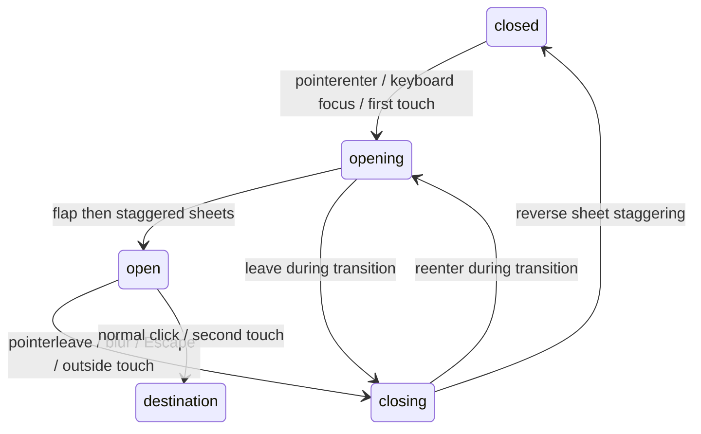

# مخطط الطبقات والحالات قبل التعديل

المصدر: نسخة العمل من ahmed-khaled-portfolio 3. البيانات والأصول وكل الأقسام الأخرى محفوظة.

```text
رابط المشروع: هدف التفاعل والتركيز واللمس
└── مساحة الفولدر: منظور ثابت؛ لا تتحرك ككتلة واحدة
    ├── 0 الجسم الخلفي واللسان العضوي
    ├── 1 ظل الفتحة / التجويف؛ يزداد أثناء الفتح
    ├── 2،3،4 أوراق مستقلة: وثائق وصورة المشروع الحقيقية
    └── 5 واجهة مستقلة بمفصلة عند أسفلها
        ├── سطح زجاج لبني + إضاءة حافة
        └── نص واضح خارج طبقة التمويه

الأدوات: الخلفية < الأيقونات في الراحة < الوجه الفحمي < الأيقونة النشطة والتلميح.
حاوية الأيقونات لا تنشئ stacking context يحبس الأيقونة المختارة.
```



معيار المعايرة: نسبة عرض الفولدر إلى ارتفاعه من الفيديو الفعلي، وتحرك الحافة العليا للأمام والأسفل مع ثبات القاع تقريبًا. لا يوجد استنتاج يقيني لقيم CSS الأصلية من الفيديو.
